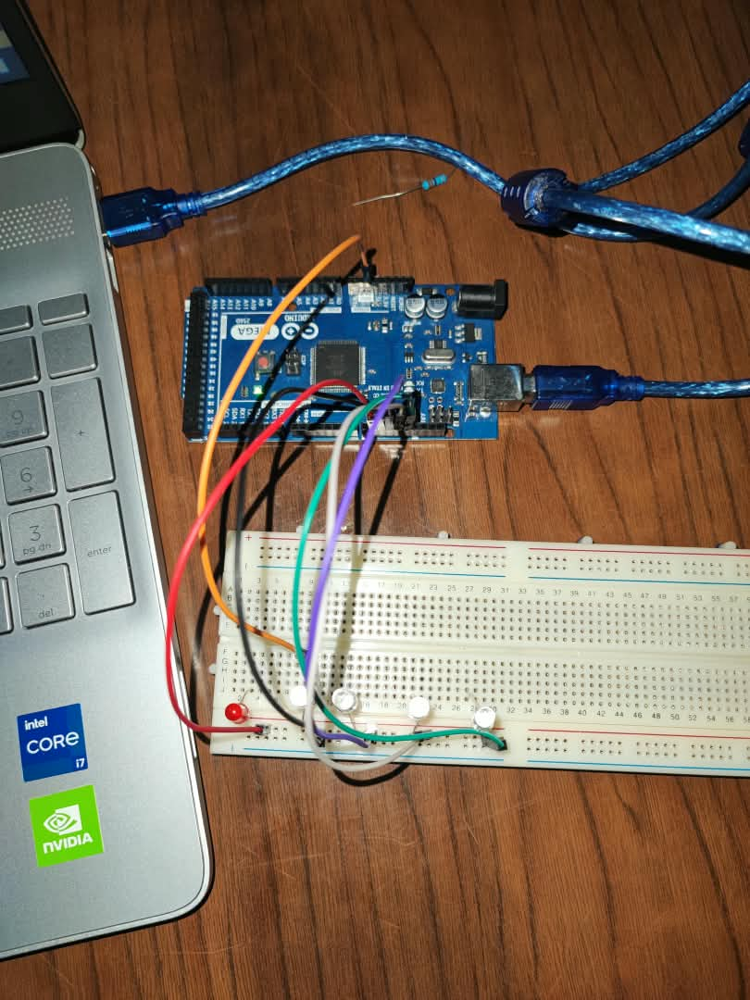
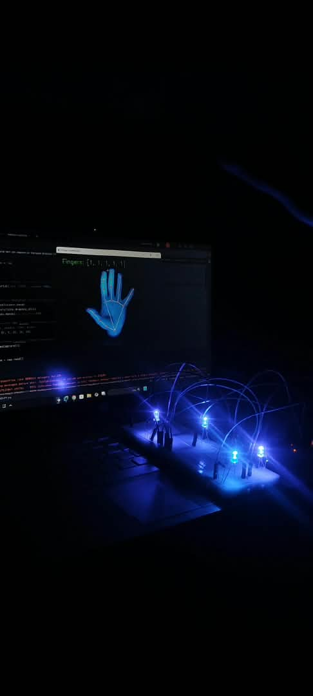

# Gesture-controlled light brightness (Python, OpenCV, MediaPipe, Arduino)

University graduation project (part 1), presented at a university exhibition.

## What it does

A webcam tracks the hand with MediaPipe Hands. The distance between two fingers is mapped to a 0-255 value and sent to an Arduino Mega over serial to dim an LED. Debouncing and timing control avoid rapid repeated commands.

## Hardware

Arduino Mega, LED, resistor, breadboard, webcam.

## Demo

Video: https://lnkd.in/p/dXQ5mp2B (link)

## Run

1. Upload `arduino/gesture_light.ino` to the board.
2. `pip install -r requirements.txt`
3. Set the serial port in `gesture_light.py` (currently `COM5`, baud `9600`).
4. `python gesture_light.py`

## Limits

No model was trained and no accuracy was measured: hand tracking comes from MediaPipe. Lighting and camera angle affect tracking. Keep your hand within the camera frame
