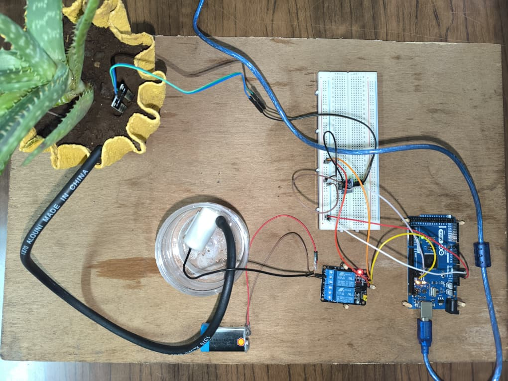

# Smart Irrigation System

University semester project, presented at a university exhibition.

An Arduino-based controller that waters soil automatically using a moisture sensor.

## Components

- Arduino UNO
- Soil moisture sensor
- Relay module and water pump
- Battery

## Wiring

## How it works

The system reads the soil moisture level. When it drops below the dry threshold (30%), the relay turns the pump on. When the soil reaches the target level (80%), the pump turns off. Both values are set at the top of `irrigation.ino`.

## Limits

No machine learning. Thresholds were calibrated for garden soil. Not tested outdoors for long periods.
